# 🏦 Bank Statement Processing & Classification System

Upload bank statement PDFs (text-based **or** scanned), extract account details and every transaction,
verify the extraction against the running balance, classify each transaction **without any LLM**
(keyword rules + a traditional ML model), review/correct in a UI, and export to **Excel / CSV**.

> Built for the Befree assessment. Everything runs locally; no external API is called.

## 🌐 Live demo: https://bank-statement-processor-7cft.onrender.com

No PDF needed: use **"Try a sample"** on the right of the page (text, scanned, mixed and password-protected
samples are included; the protected one's password is `RAHU1990` and is filled in automatically).

> ⏳ Hosted on Render's **free tier** (0.1 CPU, 512 MB): the first visit after ~15 min idle takes
> **30–60 s to wake up**. Text PDFs process in about a second; **scanned PDFs take ~20 s per page** there
> (≈4 s per page on a laptop) because OCR is CPU-bound.

---

## ✨ Features

| Requirement | How it is met |
|---|---|
| Text **and** image PDFs | PyMuPDF text layer for digital PDFs; Tesseract OCR for scanned pages |
| **Auto-detect** PDF type | Done **per page** (mixed PDFs are common) using text density, text-layer sanity and image coverage. The reason is shown in the UI |
| Multiple banks & layouts | **No bank-specific code.** The header row is found by column synonyms, and column boundaries are learned from the whitespace in the data itself. A second header-less parser acts as a fallback |
| Account details | Name, account no. (incl. masked), IFSC (+ bank name from IFSC prefix), MICR, customer ID, branch, account type, currency, statement period, opening/closing balance |
| Transactions | Date, value date, description (multi-line narrations re-joined), ref/cheque no., debit, credit, balance |
| **Accuracy** | Every row is checked: `previous balance + credit − debit = balance`. A reconciliation % is reported; mismatches are highlighted |
| Classification (no LLM) | **Hybrid:** user-learned corrections → YAML keyword rules → TF-IDF + Logistic Regression. Low-confidence rows go to *Uncategorized* for review instead of being guessed |
| Export | Excel (4 formatted sheets) and CSV |

### Real-world scenarios handled (all implemented and tested)

- 🔒 **Password-protected PDFs** (very common for Indian banks): the UI asks for the password
- 📄+🖼️ **Mixed PDFs**: some pages text, some scanned
- 🔄 **Scanned page tilt / rotation**: deskew (projection profile) + Tesseract orientation detection
- 📑 Tables spanning pages, **header repeated** on each page **or printed only on page 1**
- 🧾 **Two-line headers** (`Txn` above `Date`)
- ✂️ **Wrapped narrations**, including long UPI strings broken mid-word (re-joined without a fake space)
- 🔀 **Separate Debit/Credit columns**, **single Amount + Dr/Cr column**, or **`Cr`/`Dr` suffixes**
- ❓ **No Dr/Cr marker at all**: direction worked out from the balance change
- ⬇️ **Newest-first statements**: detected (balances only reconcile in one direction) and re-ordered
- 🇮🇳 Indian number format `1,23,456.78`, many date formats (`01/04/24`, `05-Apr-2024`, `28.06.2024`…)
- 🔤 OCR mistakes in numbers/dates (`O`→`0`, `,`↔`.`, stray specks), plus misread-but-valid dates
  (e.g. `05`→`08`) caught by period/order checks and repaired from the value date
- 🧮 Opening balance / `Balance B/F` / `C/F` / totals / page footers are not mistaken for transactions
- 🧩 Missing opening balance (inferred), swapped Dr/Cr (auto-corrected), missing amount (inferred from balance)
- 👯 Duplicate rows from repeated pages, and **overlapping statements** when several files are uploaded
- 🚫 Non-statement, corrupted, or non-PDF files → clear error, no crash
- 🧠 **Feedback loop**: corrections in the UI are remembered (same merchant/person next time) and can retrain the model

---

## 🏗️ Architecture

```mermaid
flowchart LR
    A[PDF upload] --> B{Encrypted?}
    B -- yes --> B1[Ask password]
    B1 --> C
    B -- no --> C[Per-page type detection]
    C -- text page --> D1[PyMuPDF words + positions]
    C -- scanned page --> D2[Render 300 dpi → orientation fix → deskew → binarise → Tesseract words + positions]
    D1 --> E[Same Word format x,y,text]
    D2 --> E
    E --> F[Group into lines]
    F --> G[Header detection by column synonyms]
    G --> H[Column boundaries from whitespace gutters]
    H --> I[Row assembly: date-anchored rows, wrapped lines, B/F, C/F, footers]
    F --> I2[Fallback header-less parser]
    I --> J[Pick parser whose balances reconcile best]
    I2 --> J
    J --> K[Validation: order detection, Dr/Cr inference, reconciliation, duplicates]
    K --> L[Hybrid classifier]
    L --> L1[1 user memory]
    L --> L2[2 YAML rules]
    L --> L3[3 TF-IDF + Logistic Regression]
    L --> M[Streamlit UI review & correct]
    M --> N[Excel / CSV export]
    M -- corrections --> L1
```



**Key design idea:** text pages and OCR pages are both converted to the *same* representation
(words with x/y coordinates in PDF points). So there is **one** layout parser for both; OCR is just
another word source.

### Extraction in more detail (`bankparser/layout.py`)
1. **Lines**: words are grouped by vertical centre.
2. **Header**: a line containing ≥3 known column roles (date + money columns) such as *Narration / Particulars /
   Description*, *Withdrawal / Debit / Dr*, *Deposit / Credit*, *Balance*, *Value Dt*, *Chq./Ref.No.*, *Dr/Cr*.
   Neighbouring header lines are merged.
3. **Columns**: for all transaction lines we build an x-axis occupancy histogram. Empty vertical bands
   (**gutters**) separate columns, and each band is mapped to the header cell it overlaps. This works for left-aligned text and right-aligned numbers, and when a header label is narrower than its data.
4. **Rows**: a valid date in the Date column starts a transaction. Text-only lines are wrapped
   narration, attached above/below by the **largest vertical gap**. This also covers banks that vertically centre the date in a multi-line row.
5. **Two parsers compete**: the header-based parser and a header-less "date … amount balance" parser
   both run. The one whose rows reconcile better with the running balance wins.

### Classification in more detail (`bankparser/classify/`)
| Layer | What | Why |
|---|---|---|
| 1. User memory | Exact key (description without digits + direction) from corrections | A user's decision is never overridden. Works for the same merchant/person with new reference numbers |
| 2. Rules | `config/categories.yaml`: keywords + regex + allowed direction, first match wins | ~100% precise, explainable, editable without code |
| 3. ML | TF-IDF (word 1–2 grams + **char 3–5 grams**) → Logistic Regression, probabilities masked by allowed direction (a credit can't be *Food*) | Generalises to unseen merchants and handles joined/odd tokens (`zomato12@ybl`), person-to-person transfers |
| Threshold | ML probability < 0.40 → *Uncategorized* + "needs review" | Avoids confident-looking wrong answers |

Every row shows **source** (`user` / `rule` / `ml` / `none`), **confidence** and a **reason**
(e.g. `rule: keyword 'SWIGGY'` or `ML model (Transfer Out 91%, Rent 4%, ...)`).

**Training data:** no labelled data was provided, so `synthetic/narrations.py` generates realistic Indian
narrations (UPI, NEFT, IMPS, POS, ATM, NACH, BBPS formats) for 23 categories. Evaluation is done on
**merchants never seen in training** (merchant-level split), which mirrors real use.

---

## 📊 Results

**Extraction** (`python -m scripts.evaluate_extraction`). Exact match against ground truth:

| Sample | Type | Rows | Date / Debit / Credit / Balance | Balance check |
|---|---|---|---|---|
| navyug_bank | text, Withdrawal/Deposit cols, char-wrapped UPI | 50/50 | 100% | 100% |
| sahyadri_bank | text, 2-line header, newest-first, `Cr` suffix | 55/55 | 100% | 100% |
| indus_valley_bank | text, Amount + Dr/Cr col, B/F–C/F, header on page 1 only | 56/56 | 100% | 100% |
| sahyadri_bank_protected | password protected | 55/55 | 100% | 100% |
| navyug_bank_scanned | image-only (OCR), tilted, noisy JPEG | 50/50 | 100% (descriptions 99.6% char-similar) | 100% |
| indus_valley_bank_mixed | page 1 text, page 2 scanned | 56/56 | 100% | 100% |

**OCR stress tests** (same statement re-scanned under harder conditions):

| Condition | Rows | All numbers exact | Balance check | What handled it |
|---|---|---|---|---|
| 2.5° tilt | 50/50 | 50/50 | 100% | projection-profile deskew (detected −2.5° exactly) |
| page scanned sideways (90°) | 50/50 | 50/50 | 100% | Tesseract orientation detection |
| 150 dpi, noisy | 50/50 | 50/50 | 100% | one unreadable amount **inferred from balance**, one misread date **repaired from value date** |

OCR speed: ~4–5 s per scanned page on a laptop CPU (text pages are instant).

**Classification** (`python -m bankparser.classify.train`, held-out merchants, 1,840 test rows):

| Model | Accuracy | Macro-F1 |
|---|---|---|
| Logistic Regression (ML only) | 72.3% | 0.715 |
| Linear SVM (ML only) | 73.0% | 0.728 |
| Complement Naive Bayes (ML only) | 71.3% | 0.679 |
| Random Forest (ML only) | 69.6% | 0.687 |
| Rules only | 87.5% coverage, **99.9% precision** | |
| **Hybrid (rules → LogReg)** | **96.5%** | **0.936** (2.7% sent to review) |

Logistic Regression was chosen over the slightly better SVM because it gives **calibrated probabilities**,
which the confidence threshold and "needs review" logic depend on.

*Honest caveat:* the rules contain the well-known Indian merchants, so the hybrid number is optimistic for
merchants outside that list. ML alone (~72% on brand-new merchant names) is the realistic floor; the
review queue and the feedback loop exist because of that.

---

## 🚀 Setup & run

### 1. Prerequisites
- Python **3.10 / 3.11**
- **Tesseract OCR** (only needed for scanned PDFs)
  - Windows: `winget install --id UB-Mannheim.TesseractOCR -e` (auto-detected in `C:\Program Files\Tesseract-OCR`, or set `TESSERACT_CMD`)
  - Ubuntu/Debian: `sudo apt install tesseract-ocr`
  - macOS: `brew install tesseract`

### 2. Install
```bash
python -m venv .venv
# Windows: .venv\Scripts\activate      Linux/macOS: source .venv/bin/activate
pip install -r requirements.txt
```

### 3. Run the web app
```bash
streamlit run app.py
```
Open http://localhost:8501, then upload PDFs or click **Process sample**.

### 4. Command line (batch use)
```bash
python -m bankparser samples/navyug_bank.pdf samples/sahyadri_bank.pdf -o result.xlsx --csv result.csv
python -m bankparser samples/sahyadri_bank_protected.pdf --password RAHU1990 -o protected.xlsx
```

### 5. Regenerate data / retrain / test
```bash
python -m synthetic.make_statements          # sample PDFs + ground truth (samples/)
python -m bankparser.classify.train          # evaluate 4 models, train final model -> models/
python -m scripts.evaluate_extraction -v     # extraction accuracy vs ground truth
pytest -q                                    # 60 tests
```

### 6. Docker / Render deployment
```bash
docker build -t bank-statements .
docker run -p 8501:8501 bank-statements
```
On **Render**: New → Blueprint → select this repo (uses `render.yaml` + `Dockerfile`, Tesseract included).

---

## 📁 Project structure
```
app.py                      Streamlit UI (upload, review, correct, charts, export)
bankparser/
  loader.py                 open PDF, password handling, per-page text/scan detection
  ocr.py                    Tesseract: orientation, deskew, binarisation, word boxes
  layout.py                 header detection, gutter-based columns, row assembly, fallback parser
  normalize.py              date & amount parsing (Indian formats, OCR fixes)
  account.py                account-holder details
  validator.py              reconciliation, order detection, Dr/Cr inference, duplicates
  pipeline.py               orchestration
  export.py                 Excel (4 sheets) / CSV
  classify/
    rules.py  ml.py  hybrid.py  train.py  text.py
  __main__.py               CLI
config/categories.yaml      categories + keyword rules (edit to extend, no code change)
synthetic/                  realistic statement + narration generators
samples/                    generated sample PDFs + ground_truth/ CSVs
models/                     trained model + metrics.json
tests/                      pytest suite
```

## 🧾 Sample files
All banks are **fictional**. `samples/sahyadri_bank_protected.pdf` password: **`RAHU1990`**.
`not_a_statement.pdf` demonstrates graceful rejection.

## ⚠️ Known limitations / next steps
- Synthetic data only. The next step is validating on a corpus of real anonymised statements from major banks
  and adding optional per-bank profiles where the generic parser is weak.
- Handwritten or very low-quality scans: Tesseract accuracy drops. Reconciliation flags those rows rather than hiding them.
- Multiple accounts inside one PDF are not split yet.
- English statements only (Hindi/regional OCR packs could be added).
- ML would benefit from real labelled data; the feedback loop is the path to collect it.
